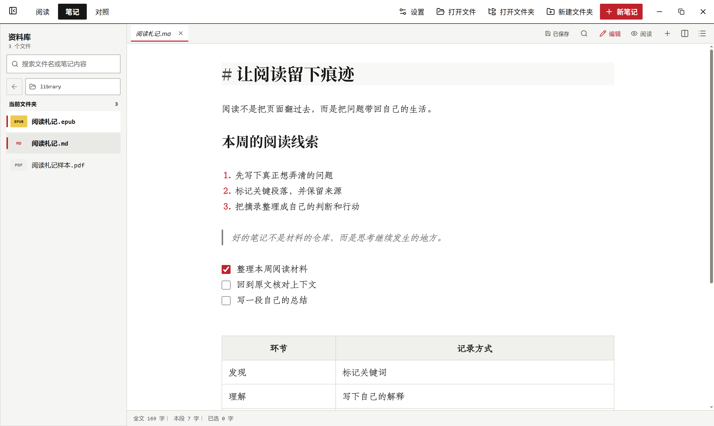
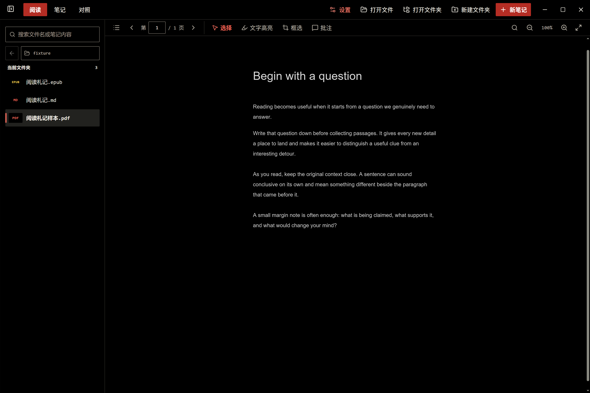
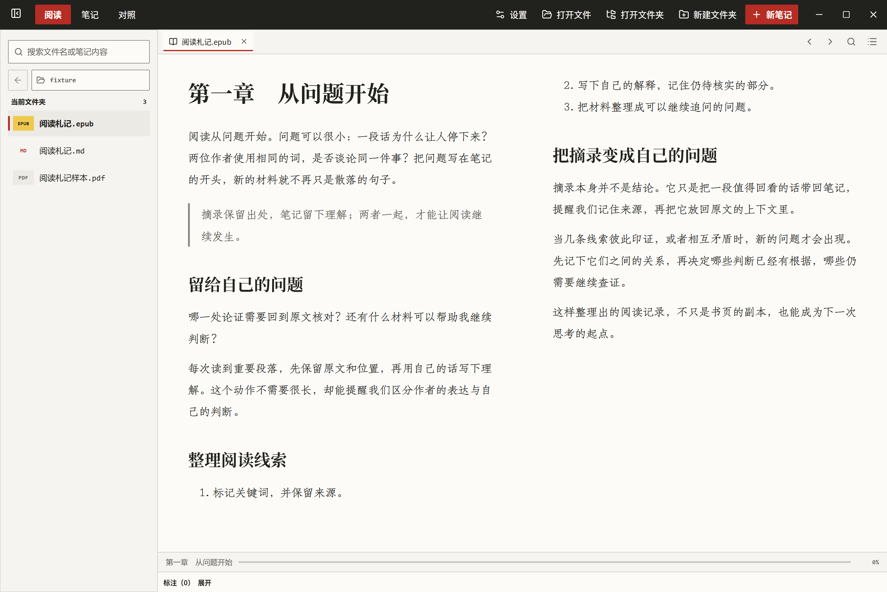

# 左人笔记


面向本地资料阅读与 Markdown 写作的 Windows 桌面笔记软件。以 Markdown 为核心，也可以在同一工作区阅读 PDF、EPUB，并把摘录整理进笔记。

**[下载 Windows 安装版（0.3.3）](https://github.com/barbarians1999/zuoren-notes/releases/latest)** · [查看全部版本](https://github.com/barbarians1999/zuoren-notes/releases)

下方为左人笔记 0.3.3 的实际运行截图，笔记与书籍内容使用演示样本。

## 功能预览

### Markdown 写作



提供接近 Obsidian 的 Live Preview 编辑方式：在 Markdown 源文本中直接写作，标题、列表、引用、表格等格式在编辑时即时呈现，并支持撤销与自动保存。

### PDF 阅读与摘录



支持页码跳转、缩放、全文查找、文字选择、高亮、批注和摘录；深色模式下可切换深色阅读效果。摘录可进入当前笔记，方便边读边整理。

### EPUB 阅读



支持目录导航、双页阅读、滚轮或方向键翻页、全书搜索，以及把选段摘录到笔记。

## 主要特点

- **本地文件优先**：笔记和书籍保存在你自己的文件夹中，不要求使用云服务。
- **写作与阅读连贯**：Markdown、PDF、EPUB 和笔记分栏协作，阅读摘录可回到笔记中继续编辑。
- **保护编辑内容**：自动保存、撤销、恢复稿和外部文件冲突保护，尽量避免意外丢失修改。
- **专注阅读**：支持阅读位置恢复、PDF 标注与 EPUB 目录和搜索。
- **Windows 桌面应用**：提供安装版，并支持从文件或文件夹打开资料。

## 获取与开发

从 [GitHub Releases](https://github.com/barbarians1999/zuoren-notes/releases/latest) 下载最新的 Windows 安装包。

开发环境需要 Node.js 与 pnpm：

```powershell
pnpm install
pnpm build
pnpm start
```

常用验证与打包命令：

```powershell
pnpm test
pnpm test:readers
pnpm package:installer
```

项目目前未附带开源许可证；如需再分发源码或构建产物，请先确认第三方字体及依赖的许可条件。
